<p align="center">
  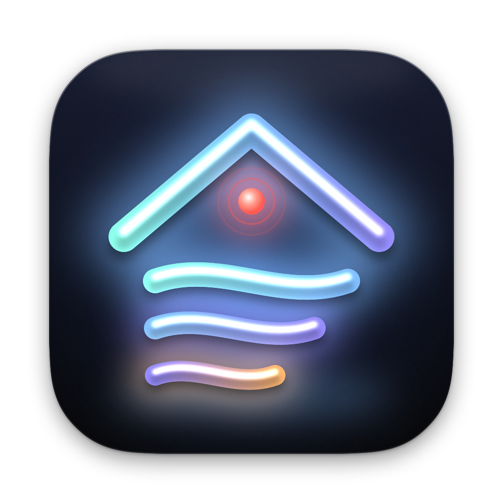
</p>

<h1 align="center">Hearth</h1>

<p align="center">
  <b>Your whole home, one click away in the Mac menu bar.</b><br>
  A native macOS app for Home Assistant: air conditioning you can feel, live cameras,<br>
  every room and device, and an activity feed that tells you when someone's at the door.
</p>

<p align="center">
  <picture>
    <source media="(prefers-color-scheme: light)" srcset="docs/art/hearth-native-showcase-light.png">
    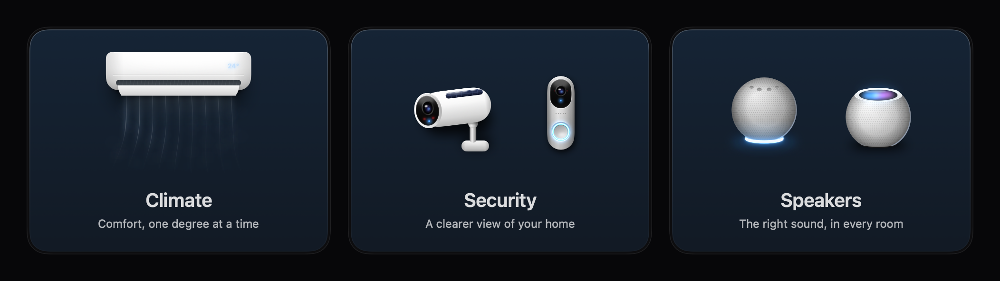
  </picture>
</p>

---

## Download

[Download Hearth 0.1.10 for Apple Silicon and Intel](https://github.com/obileonardo/hearth-macos/releases/download/v0.1.10/Hearth-0.1.10-universal.dmg) · [Release notes and checksum](https://github.com/obileonardo/hearth-macos/releases/tag/v0.1.10)

**Signed with a Developer ID and notarized by Apple**, with the notarization ticket stapled to both the disk image and the app, so macOS opens it without an unidentified-developer warning. Requires macOS 14 or later. You can also [build from source](#4-build-or-open-hearth). See [verification](docs/release-verification-0.1.10.md) and the [task register](Task%20Update/README.md).

Or install it from Terminal with [Homebrew](https://brew.sh):

```sh
brew install --cask obileonardo/hearth/hearth
```

This installs the same notarized disk image, checked against its SHA-256. Update with `brew upgrade --cask hearth`; remove with `brew uninstall --cask hearth`, adding `--zap` to also remove Hearth's settings and saved data. The [Hearth tap](https://github.com/obileonardo/homebrew-hearth) follows each release once it installs and verifies on a clean Mac.

## Your home, in six views

Hearth brings the devices and services already connected to Home Assistant into a native Mac interface. Check a camera, change the temperature or find a room’s controls without opening a browser. Your Home Assistant server supplies the readings and supported actions; Hearth brings them together on your desktop.

| View | What you can do |
|---|---|
| **Climate** | Open an air conditioner’s own page for temperature, mode and fan controls, with animated airflow that follows its reported state. |
| **Security** | See camera and doorbell updates, open supported live streams, review activity and access the alarm controls your integration exposes. |
| **Speakers** | Browse a grid or list by room, see playback and reported groups, and play, pause or announce on supported devices. |
| **Energy** | Follow solar, battery, grid and home power; inspect the readings and history available from your connected sensors. |
| **Assets** | Start with your home, then explore energy, vehicles, gadgets and speakers. Add a manual entry when a device has no integration. |
| **Rooms** | Browse by floor in Overview, or select a room in the interactive browser while its devices stay in view. |

The opening showcase is a native illustration of these six areas. The guides below show their actual views with offline sample data. Device support depends on the Home Assistant integration; a demo reading is not a compatibility claim.

<details>
<summary><b>Explore the views and their controls</b></summary>

- **Climate.** Every air conditioner gets its own page: an illustrated unit whose louver opens when it runs, airflow that streams out in the colour of the mode, a set-point track with a tick for every degree, mode and fan speed controls, swing, sleep timer, display light and today's energy use.
- **Security.** Your doorbell leads, streaming live (WebRTC, the same way Home Assistant's own app does it). Every other camera sits in a grid with its latest picture and when it last saw movement. Alarm systems arm and disarm in one tap.
- **Rooms.** Hearth reads the rooms and floors you set up in Home Assistant. Open a room to see its devices, open a device to see everything it can do, explained in plain language and grouped into sections like Detection, Alerts, Camera and Sound.
- **Gadgets.** 3D printers, games consoles and computers in one place. A Bambu Lab printer shows its progress, time left and temperatures, with a picture of what it's printing. Anything Home Assistant doesn't know about you can list by hand, with an address if you'd like Hearth to check it's on.
- **Vehicles.** Electric cars, chargers, robot vacuums, robot mowers and anything else that moves on a battery. A car shows its charge, range, whether it's charging and how long until full, where it is and whether it's locked, with buttons to lock, charge and warm or cool it (unlocking asks twice). Vacuums and mowers start, pause and go home from their card. Aircraft and anything else without a Home Assistant integration you can list by hand.
- **Energy.** Inverters, lithium batteries and solar panels. A live diagram shows power flowing between the sun, the battery, the grid and the house. The battery shows its charge, how fast it's charging and when it'll be full; solar shows what it's making now, today and over the last day; the inverter shows its mode, load, temperature and any faults; and a battery's BMS shows every cell. Hearth reads Home Assistant's Energy dashboard setup first.
- **Homes.** Your home as a card with what it's using now and today, and room for more homes (a second house, a flat, the office). Link devices and hand-added gadgets to each one; everything not linked lives in your main home. A home's page ranks what's drawing the most power right now, adds up the devices that report their use against the whole-house figure, and lists everything in it. A demo home shows it all before anything is connected.
- **Activity.** A timeline of people seen, doorbell rings, motion, the alarm and the air conditioning, with pictures. Choose what sends a Mac notification.
- **Live pill and desktop widgets.** Optional event alerts beneath the menu bar, plus clickable, movable and resizable widgets for climate, recent activity and energy. Choose widgets and the climate source in Settings. The overview adapts to connected readings. See [widgets](docs/widgets.md).
- **Car illustrations.** Recognisable electric car models with a remembered paint choice. The vehicle demo lets you change both car and paint without controlling a real vehicle.
- **Speakers.** Open **Assets → Speakers** for a room-labelled grid or list, connection state, animated playback waves and reported groups. Resume existing playback, request music or choose a media source where supported; announcements use the device’s exposed notification action.
- **Faces and maps.** Optional familiar-face matching runs on this Mac. Import a home scan for the 3D map, with floor selection, plan view, transparent walls and device placement.
- **Light, dark or system.** Choose in Settings. Theme text tokens have documented contrast calculations for light and dark appearances; Hearth supports Increase Contrast, Reduce Transparency and Reduce Motion. See [docs/accessibility.md](docs/accessibility.md).
- **Native.** Built in SwiftUI. Hearth signs in to your Home Assistant and keeps its refresh token in your Keychain. Hearth has no analytics or account service; see [Privacy](#privacy) for its network and local storage behaviour.

</details>

<details>
<summary><b>Explore the full device illustration library</b></summary>

The [full artwork sheet](docs/art/devices.png) includes every device and its on/off variants. The introduction above is rendered from Hearth's native device illustrations. See [artwork notes](docs/art/showcase.md) for the earlier device-family illustration.

</details>

## In the app

### Demo views and illustrated setup steps

The views below use offline sample data, with no personal camera pictures, household configuration or account information. Sign-in fields, the bug draft's **Subject** and **Message** fields, and the optional version-information switch are static documentation illustrations: the offscreen exporter cannot render these native controls. They remain native, interactive controls in the app. Device readings and playback states shown here are examples.

The download is the published 0.1.10 release. Its [verification record](docs/release-verification-0.1.10.md) identifies its exact source and limitations. Source-guide images are regenerated separately from synthetic data; their [image register](docs/screenshots/README.md) records the export method and which controls are illustrated.

<table>
  <tr>
    <td valign="top" width="50%">
      <h3>Assets · dark</h3>
      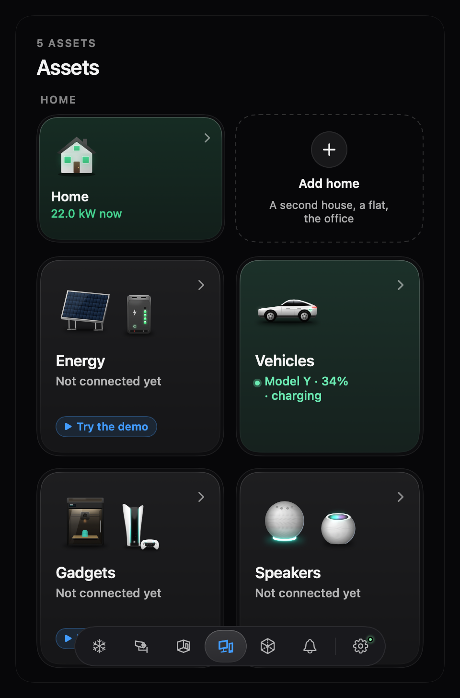
      <p>Open your home or a device family from one overview.</p>
    </td>
    <td valign="top" width="50%">
      <h3>Assets · light</h3>
      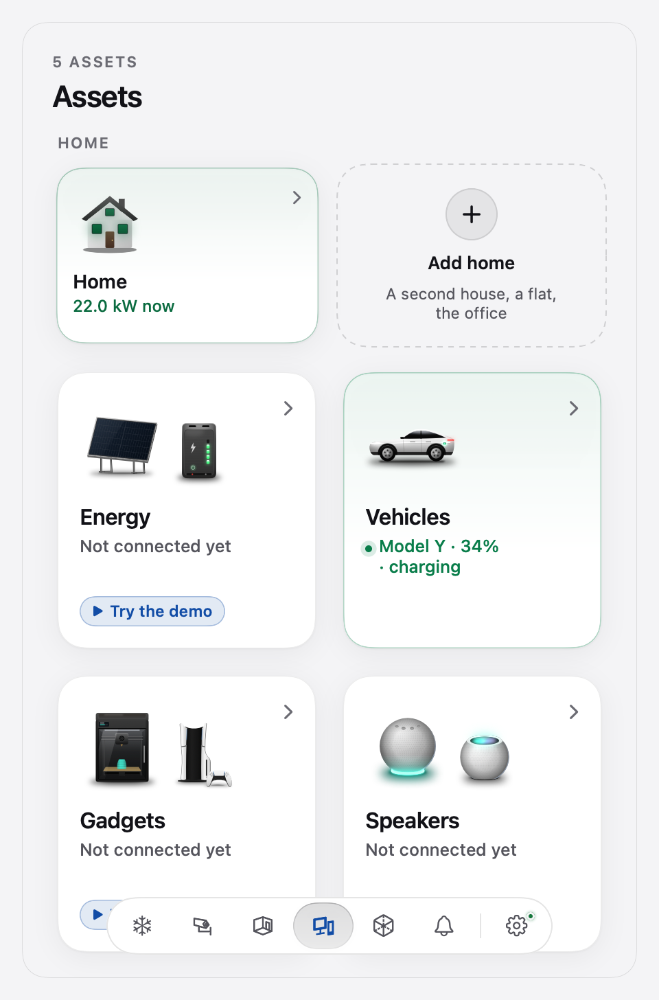
      <p>The same navigation, adapted for light appearance.</p>
    </td>
  </tr>
  <tr>
    <td valign="top" width="50%">
      <h3>Speakers · dark</h3>
      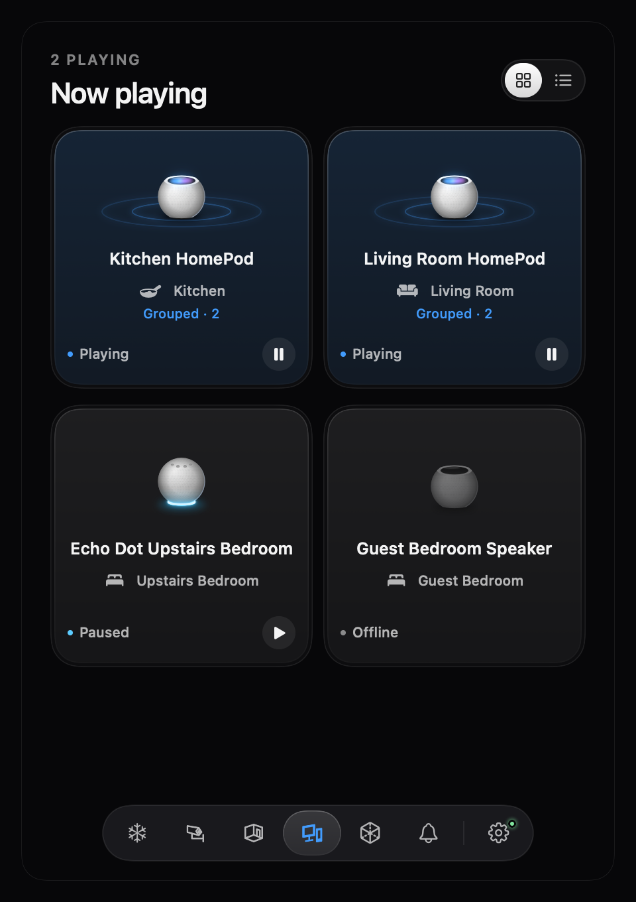
      <p>See each speaker's room, playback state and group.</p>
    </td>
    <td valign="top" width="50%">
      <h3>Climate · dark</h3>
      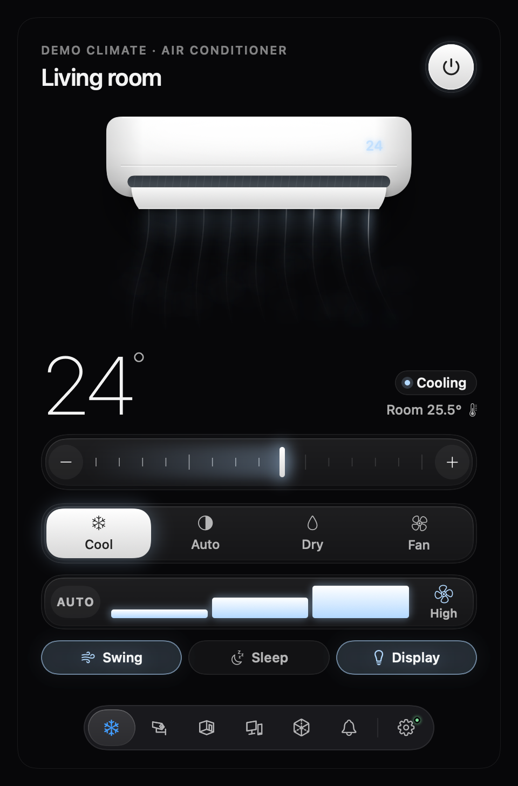
      <p>Adjust the set point and mode on the unit's own page.</p>
    </td>
  </tr>
</table>

### A map of your home

Import a home scan, choose a floor and place your devices. Switch between 3D and Plan, or change the wall visibility to see inside. This two-floor demo uses generated rooms, device placements and simulated energy readings.

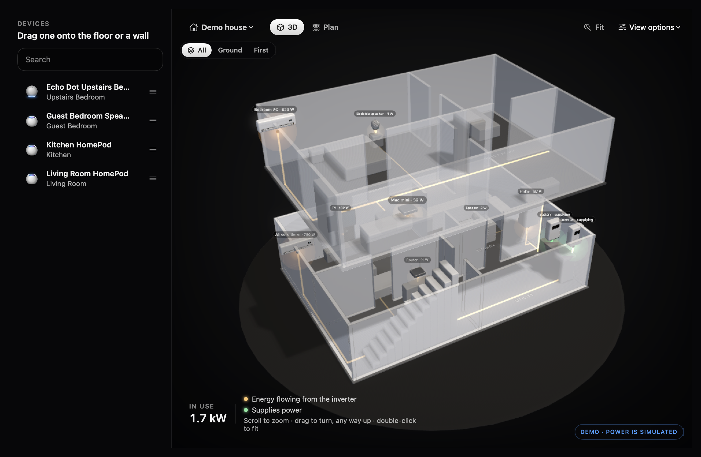

### Light, Dark or System

Choose **Settings → Appearance → Light, Dark or System**. System follows your Mac; the other choices keep Hearth in the appearance you prefer. The map, cards, text and controls adapt together.

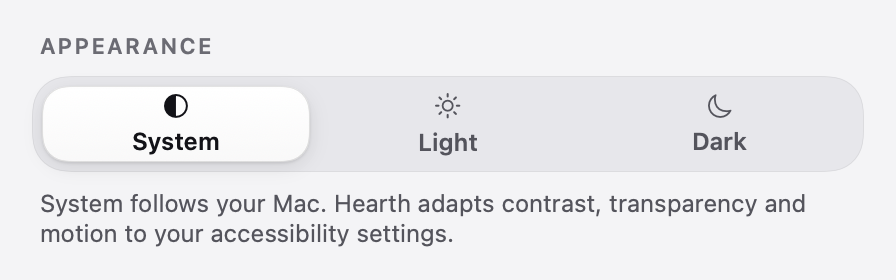

#### The same home, in light mode

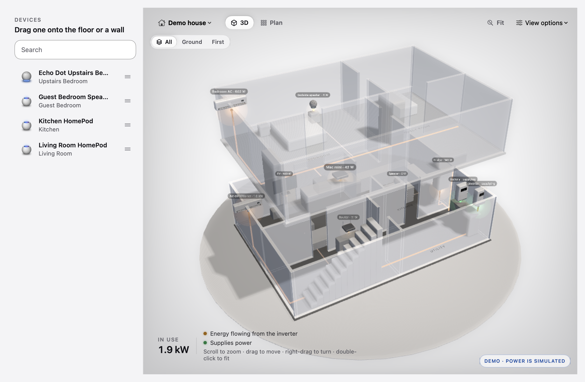

The light view uses the same demo scene and camera position, rendered with the map’s light surfaces, labels and controls.

For the floating navigation and page headings, adjust **Settings → Navigation → Glass opacity**. Icons and labels retain full opacity. macOS **Reduce Transparency** or **Increase Contrast** uses a solid surface without discarding your saved preference; **Reduce Motion** limits animation. These offscreen images show the authored layout, not the Mac’s live glass composition. [Appearance and accessibility](docs/accessibility.md) · [Map guide](docs/3d-map.md)

## Requirements

- macOS 14 Sonoma or later
- A Home Assistant server (2024.4 or later) on your network
- To build from source: Xcode 26 or compatible Command Line Tools with a macOS 26 SDK. The app uses macOS 26 APIs behind availability guards while retaining a macOS 14 deployment target.

## Get started

### 1. Download the app or clone the source

Use the [download](#download) to try the packaged app. To build it yourself, or to use the optional Docker examples below, clone first:

```sh
git clone https://github.com/obileonardo/hearth-macos.git
cd hearth-macos
```

The following repository-relative commands assume this directory. A source build can be reviewed without replacing an existing Hearth installation.

### 2. Have Home Assistant running

Hearth is a remote control for [Home Assistant](https://www.home-assistant.io), the open-source home automation platform. If you already run it, skip to step 3.

If you don't, pick one:

| Option | Good for |
|---|---|
| [Home Assistant Green](https://www.home-assistant.io/green) | The easiest: a small box that runs it 24/7 |
| [Home Assistant OS on a Raspberry Pi or mini PC](https://www.home-assistant.io/installation/) | Always on, very capable |
| **On this Mac with Docker** (below) | Trying it out today, free |

<details>
<summary><b>Run Home Assistant on your Mac</b></summary>

```sh
brew install colima docker docker-compose
colima start --vm-type vz --cpu 2 --memory 3
# Only for a new setup; do not overwrite an existing .env.
cp -n homeassistant/.env.example homeassistant/.env
# Set a new HEARTH_DATA directory and TZ before starting a service.
docker-compose -f homeassistant/docker-compose.yml up -d
```

Review [the container isolation and maintenance notes](docs/optional-containers.md) first. The example publishes port 8123 without a loopback restriction; decide the appropriate network binding before use. Open <http://localhost:8123> and create your Home Assistant account. To start Colima at login, run `brew services start colima`. Home Assistant only runs while your Mac is awake; a dedicated box is better long-term.

</details>

### 3. Add your devices to Home Assistant

In Home Assistant, go to **Settings → Devices & services → Add integration** and add your supported brands. Hearth reads their devices, state and available controls. Some community integrations need [HACS](https://hacs.xyz) first; see [Brand notes](#brand-notes).

For Apple Home accessories, choose the right direction: **HomeKit Device** brings a supported accessory into Home Assistant; **HomeKit Bridge** exposes supported Home Assistant entities to Apple Home. Follow the [HomeKit walkthrough](docs/homekit.md) before changing any existing pairing.

### 4. Build or open Hearth

If you downloaded the app, follow the installation notes in the disk image; a Homebrew install is ready in Applications. For source builds:

```sh
scripts/build.sh --no-install     # builds build/Hearth.app; preserves the installed app
open build/Hearth.app
```

Quit an already running copy before opening a second build with the same bundle identifier. A normal `scripts/build.sh` release build installs into `~/Applications`; use it only when ready to replace your installed copy. [Safe development setup](docs/local-development.md).

### 5. Sign in

1. Open Hearth from the Mac menu bar. Enter the Home Assistant address you already use in a browser, for example `http://homeassistant.local:8123`. Prefer HTTPS on shared or remote networks.
2. Enter your **Home Assistant** username and password, then choose **Sign in**. Hearth stores the refresh token in Keychain, not your password.
3. Open **Settings → Signed in as…** (the **Server & integrations** row) to check the connection. Then browse **Rooms** or **Assets**; empty categories mean the server has not exposed matching devices yet.

<table>
  <tr>
    <td valign="top" width="50%">
      <h3>Connect your server</h3>
      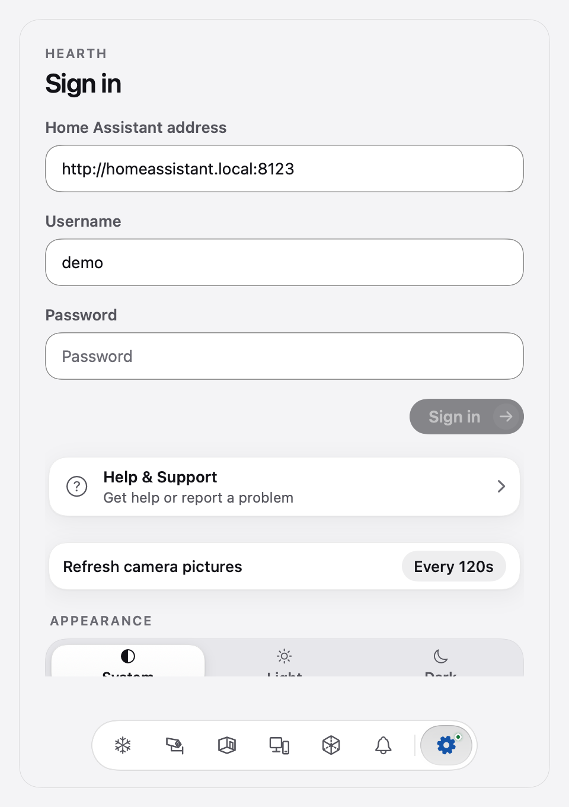
      <p>Use your own Home Assistant address and account. These illustrated fields contain no real credentials.</p>
    </td>
    <td valign="top" width="50%">
      <h3>Check your connection</h3>
      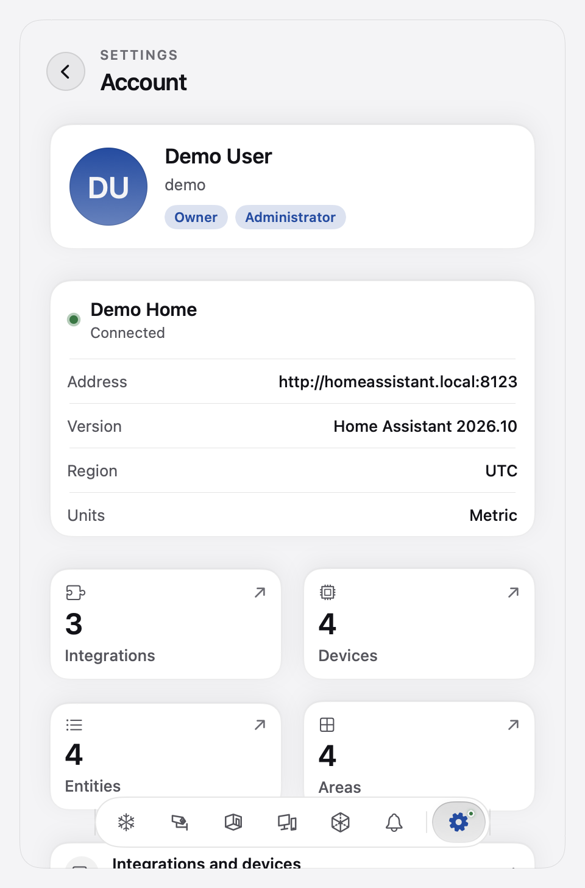
      <p>Confirm the server and connection status before exploring Rooms and Assets. This account is synthetic.</p>
    </td>
  </tr>
</table>

**MFA sign-in is not supported yet.** Keep MFA enabled; do not weaken your account to use this preview. [Connection guide and troubleshooting](docs/using-hearth.md#connect-your-own-server).

#### Manage integrations from Hearth

Open **Settings → Signed in as… → Integrations and devices → Add integration**. Search for a supported brand or service and follow Home Assistant's setup form. Some flows open a browser; unsupported steps offer **Open in Home Assistant**. Available integrations and permissions come from your server, and a community integration must already be installed there. [Integration setup guide](docs/using-hearth.md#add-and-review-integrations).

Want Apple Home too? The [HomeKit walkthrough](docs/homekit.md) explains importing accessories, bridging entities to Apple Home and preserving existing pairings. Hearth does not directly import your Apple Home household.

#### Review the integrations already connected

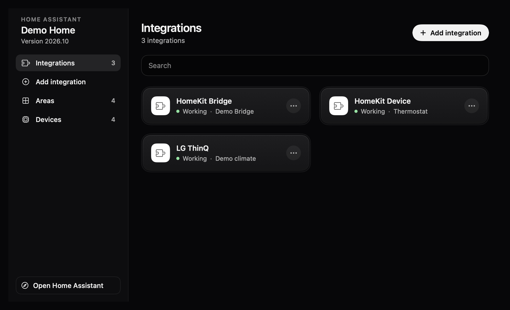

See which integrations Home Assistant has loaded. The names and working states here are offline examples.

#### Find a supported integration

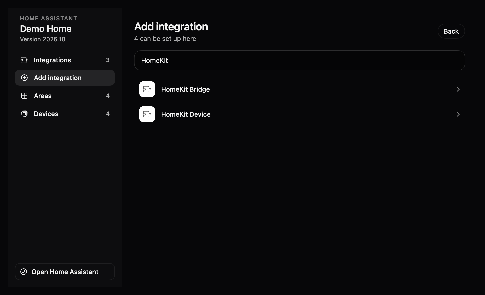

Search the server’s catalog, then follow its setup. These examples do not pair a real accessory.


### 6. Put devices in rooms

Rooms and floors come from Home Assistant:

1. Open **Home Assistant → Settings → Areas, labels & zones**.
2. Create your rooms, such as Kitchen or Living Room, and optional floors.
3. Assign each device to its room in Home Assistant's device settings.
4. Open **Rooms** in Hearth to browse that arrangement and its devices.

Choose the overview for rooms grouped by floor, or drag/scroll the square cards in the interactive view to select a room and see its devices without leaving the page. Both lead to the same existing device controls; the interactive layout is not a measured floor plan.

<table>
  <tr>
    <td valign="top" width="50%">
      <h3>Rooms by floor</h3>
      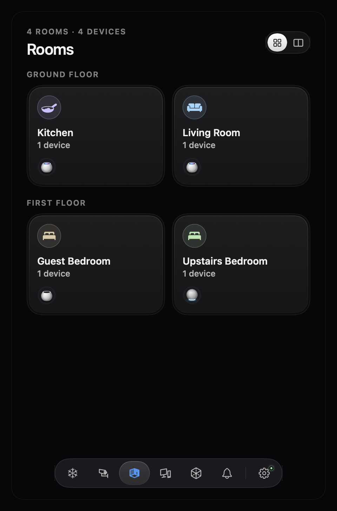
      <p>Home Assistant supplies rooms and floor assignments.</p>
    </td>
    <td valign="top" width="50%">
      <h3>Select a room, see its devices</h3>
      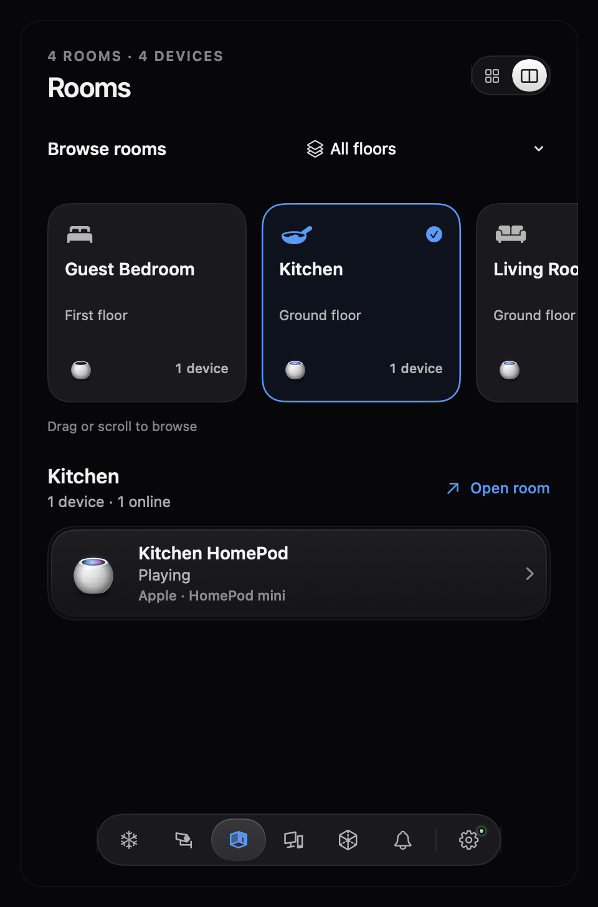
      <p>Choose a floor or room, then open a device's controls.</p>
    </td>
  </tr>
</table>

### 7. Choose a view and use its controls

Use **Assets** to browse families, **Rooms** to browse by location, or **3D Map** to place devices in a home scan. Open an air conditioner for temperature and mode controls. In **Assets → Speakers**, switch between grid and list, then use the playback controls on a connected speaker. Available controls depend on what its Home Assistant integration exposes.

<table>
  <tr>
    <td valign="top" width="50%">
      <h3>Adjust the climate</h3>
      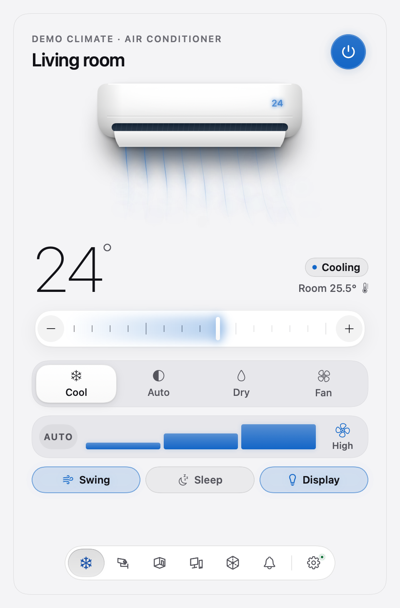
      <p>Choose a set point and mode; illustrated airflow follows the unit's state.</p>
    </td>
    <td valign="top" width="50%">
      <h3>Browse your speakers</h3>
      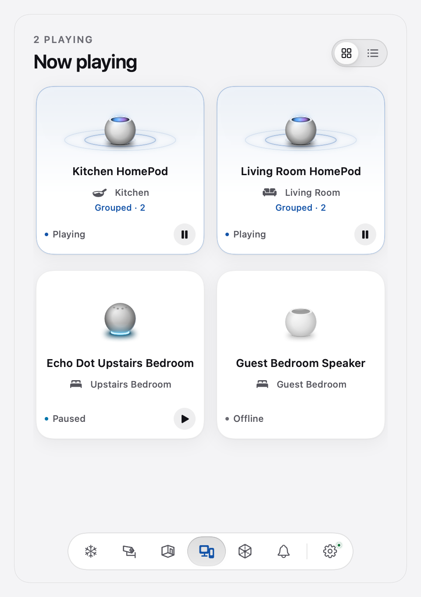
      <p>Grid and list show the same speakers. Playing speakers display sound waves.</p>
    </td>
  </tr>
</table>

#### Choose how much content shows through the bar

Open **Settings → Navigation → Glass opacity**. Move the slider toward Clearer or More opaque; Hearth remembers the choice. The same preference controls floating page headings. Icons keep their full color. macOS Reduce Transparency and Increase Contrast keep the bar solid. [Navigation guide](docs/navigation.md).

<table>
  <tr>
    <td valign="top">
      <h4>Navigation settings · dark</h4>
      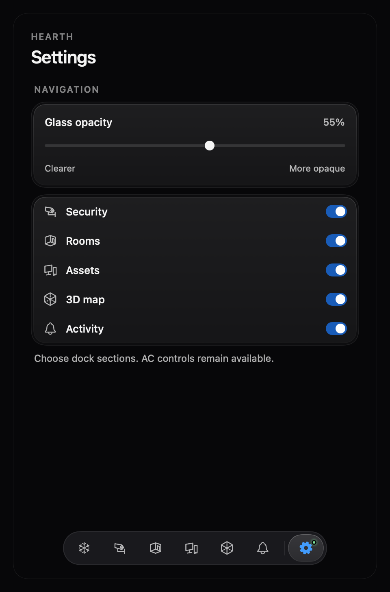
    </td>
    <td valign="top">
      <h4>Navigation settings · light</h4>
      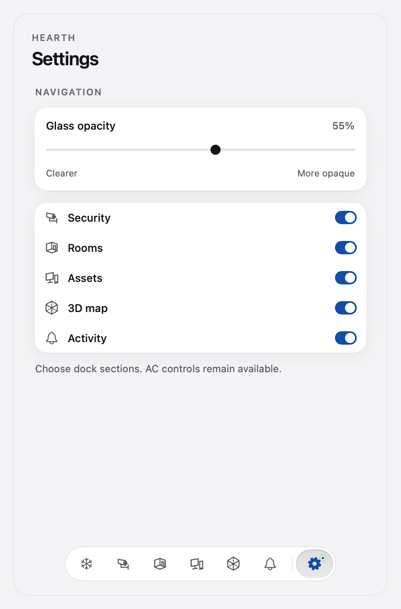
    </td>
  </tr>
</table>

The navigation section is shown in isolation with offline demo data; the offscreen slider and glass use the static documentation fallback. The running app uses native interactive controls.

### 8. Get help or report a problem

Open **Settings → Help & Support**. Start with the connection and device checks. App and macOS version numbers are optional and off by default.

#### Edit a bug report before sending

1. Choose **Report a bug** or **Get help** to open a local draft inside Hearth.
2. Edit **Subject** and **Message**. For a bug report, describe what you tried, what you expected and what happened.
3. Choose **Open mail app** to continue with that draft in your mail app, then send it yourself. Or choose **Copy draft** and paste it into a new email to `contact@elvisobi.com` in your preferred webmail service. Copy also works when no mail app is configured.

Hearth does not send the report automatically or attach logs, account details or camera pictures. You review and decide what to include.

<table>
  <tr>
    <td valign="top" width="50%">
      <h3>Start with Help</h3>
      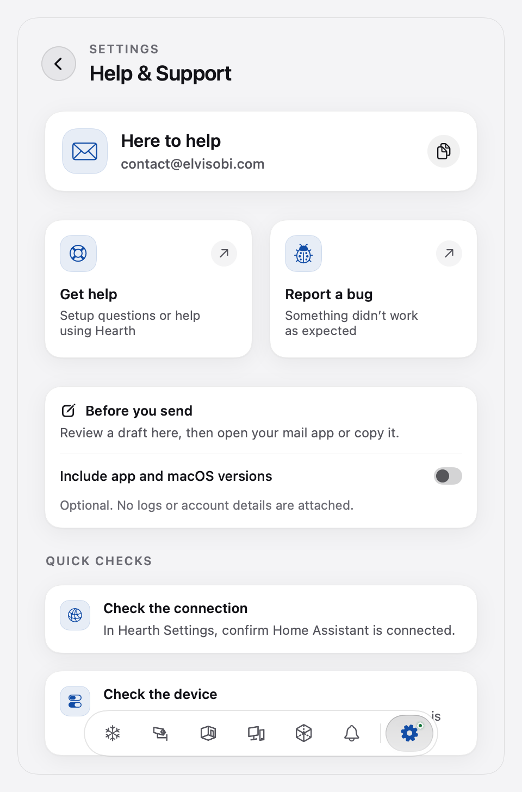
      <p>Check your connection or device, then choose a request.</p>
    </td>
    <td valign="top" width="50%">
      <h3>Review your draft</h3>
      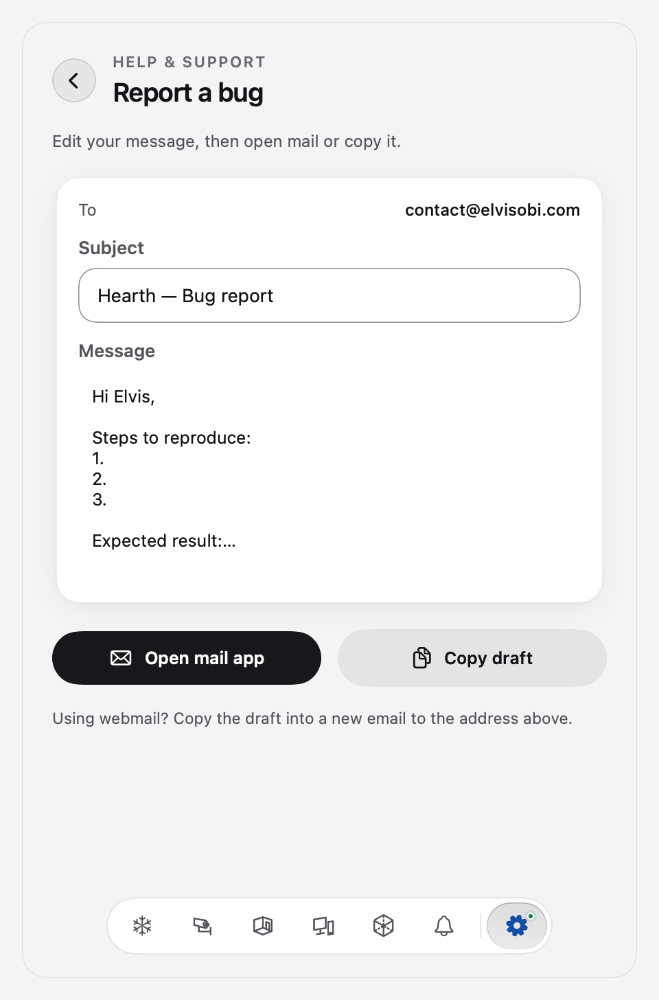
      <p>Edit first. Continue in your mail app or copy into webmail.</p>
    </td>
  </tr>
</table>

## Brand notes

| Brand | How | Notes |
|---|---|---|
| **LG ThinQ** (air conditioners) | Built-in integration | Needs a personal token from [connect-pat.lgthinq.com](https://connect-pat.lgthinq.com). Pick the **country your LG account belongs to**; a token only works in its own region. If the display light switch does nothing, see [patches](homeassistant/patches). |
| **Ring** (doorbells, cameras) | Built-in integration | Two-factor code once. Live view works through WebRTC. |
| **Amazon Echo** | Built-in **Alexa Devices** | Needs Amazon 2-step verification with an **authenticator app**. Sign in with the email or phone number your Amazon account actually uses. If you see "Invalid authentication" with correct details, see [patches](homeassistant/patches). |
| **Eufy** (cameras, HomeBase) | [Eufy Security](https://github.com/fuatakgun/eufy_security) from HACS, plus the `eufy-security-ws` bridge | Use a second Eufy account that your devices are shared with (Eufy allows one session per account). The bridge is in `homeassistant/docker-compose.yml` under the `eufy` profile. |
| **Apple TV, HomePod** | Built-in **Apple TV** | Follow the [official pairing flow](https://www.home-assistant.io/integrations/apple_tv/); review your model’s AirPlay/Home permissions before changing them. Keep the PIN private. Docker discovery troubleshooting is separate from [HomeKit setup](docs/homekit.md); optional [patch notes](homeassistant/patches/README.md). |
| **Bambu Lab** (3D printers) | [Bambu Lab](https://github.com/greghesp/ha-bambulab) from HACS | Sign in with your Bambu account, or use LAN mode with the printer's access code. Prints show on the Gadgets page. |
| **PlayStation** | Built-in **PlayStation Network** | Sign in with your PSN account. Shows when the console is on and what's playing. |
| **Tesla** | Built-in **Tesla Fleet**, or **Teslemetry** or **Tessie** | Charge, range, charging, location, locks and climate show on the Vehicles page. |
| **Other electric cars** | Built-in **BMW Connected Drive**, **Renault**, **Nissan Leaf**; HACS for Kia and Hyundai, Volkswagen, Polestar, Rivian, Mercedes | BYD has community integrations only. A charger integration shows charging for any car. |
| **EV chargers** | Built-in **Wallbox**, **Easee**, **Tesla Wall Connector**; others such as Zaptec and ChargePoint where available | Charging state, power and energy this session. |
| **Robot vacuums** | Built-in **Roborock**, **Ecovacs**, **iRobot Roomba**; Dreame from HACS | Start, pause and send home from the Vehicles page. |
| **Robot mowers** | Built-in **Husqvarna Automower** | Mow, pause and dock. |
| **Electric aircraft, drones** | No Home Assistant integration yet | Add them by hand on the Vehicles page. |
| **Solar inverters** | Built in: Enphase Envoy, SolarEdge, Fronius, SMA, GoodWe, Growatt, Solax, APsystems | Then set up **Settings → Dashboards → Energy** with your solar, battery and grid sensors; Hearth reads that setup first. |
| **Deye, Sunsynk and Wi-Fi logger inverters** | [Solarman](https://github.com/davidrapan/ha-solarman) from HACS | Reads the Solarman Wi-Fi stick directly on your network. Many hybrid inverters sold under other names use the same stick. |
| **Voltronic, MUST and other off-grid inverters** | Community add-ons | Often rebranded (possibly including CWORTH). Connect over USB or serial with a community add-on, or through a Solarman-style Wi-Fi logger if yours has one. |
| **Lithium batteries** | [BMS BLE](https://github.com/patman15/BMS_BLE-HA) from HACS, or ESPHome | Reads JK, Daly and many other BMSs over Bluetooth, including each cell's voltage. Tesla Powerwall and Victron over Bluetooth are built in. |
| **Hisense / ConnectLife** | [ConnectLife](https://github.com/oyvindwe/connectlife-ha) from HACS | Uses your ConnectLife app login. |

## Help and support

Open **Settings → Help & Support** to ask a question or report a bug. The current source opens an editable local draft to [contact@elvisobi.com](mailto:contact@elvisobi.com), with **Subject** and **Message** fields. Choose **Open mail app** to continue in your mail app or **Copy draft** for webmail; you send it yourself. App and macOS version numbers are optional and off by default. Useful bug reports include the steps, expected result and actual result.

For security concerns, follow [SECURITY.md](SECURITY.md).

## Privacy

Hearth connects to your configured Home Assistant for state, commands and sign-in. It also fetches integration icons from `brands.home-assistant.io`, can load external album artwork supplied by Home Assistant, and opens the Home Assistant web interface in a temporary web session. Artwork requests send your Home Assistant bearer token only to the configured server's origin; cross-origin redirects have that token removed.

Gadgets entered by hand can receive periodic TCP reachability checks at the address you supply. Camera streams follow Home Assistant's integration and signalling path; those integrations may use their vendors' cloud services. Hearth sends no analytics and runs no account server.

The refresh token is stored in macOS Keychain. Homes, manual gadgets, maps, activity pictures and optional face samples are stored in `~/Library/Application Support/Hearth`; paint and display choices use UserDefaults. Face matching uses Apple's Vision framework on this Mac. Privacy blur covers camera images in the app, live pill and desktop widgets; it does not remove saved images. Clearing the activity timeline currently leaves its image files on disk.

For a Home Assistant address across a shared network, prefer HTTPS. Plain HTTP exposes sign-in and session traffic to others who can inspect that network. Local development tools such as `--probe` act with the app's Home Assistant session; run them only with commands you understand. See [SECURITY.md](SECURITY.md).

## Development

```sh
scripts/build.sh --debug                     # debug build in build/
scripts/build.sh --no-install                # release build in build/, leaves installed app intact
HA_URL=http://localhost:8124 HA_TOKEN=... build/Hearth.app/Contents/MacOS/Hearth --window
```

- `--window` opens the panel in a normal window; `--snapshot out.png` renders it to an image.
- `-open <page>` opens a page (`security`, `rooms`, `devices`, `speakers`, `map`, `gadgets`, `energy`, `vehicles`, `activity` or a climate entity id); `-openDevice <id>` opens a device.
- `-gadgetsFile <path>` reads and writes the hand-made gadget list somewhere else, so tests leave yours alone.
- `-homesFile <path>` does the same for the homes list; `-openHome main|demo` opens a home straight away.
- `-activityFolder <path>` isolates the activity index and its pictures for development.
- `--render-preview <folder>` exports sample-data car, Assets, pill, settings and widget previews, then exits before connecting or asking for notification permission. Activity is explicitly in memory from app initialization; no saved event index, face reference or camera image is loaded for these renders.
- `--render-cars <folder>` exports the car contact sheets. `HEARTH_SDKROOT` selects an installed SDK; build scripts otherwise discover it, retaining the working macOS 26.5 SDK with Command Line Tools when available.
- `--probe "find climate.; call climate.set_temperature climate.bedroom {\"temperature\":22}"` checks a real Home Assistant through the app's own sign-in and prints what happened. Steps: `dump`, `find`, `call`, `cmd`, `rest`, `energy`, `snap`, `wait`.
- The optional Compose `dev` profile starts a separate Home Assistant on port 8124; it does **not** seed devices automatically. Complete onboarding, then follow the [vehicle fixture setup](docs/local-development.md#optional-home-assistant-fixtures) in a disposable environment. Use `--render-preview` for offline sample screens without a server.

[Local development](docs/local-development.md) explains safe first-run setup, isolated fixtures and authentication limits. [Using Hearth](docs/using-hearth.md) explains the main views and integration prerequisites. Optional container lifecycle and pinning are covered in [the deployment notes](docs/optional-containers.md).

Read the [architecture overview](docs/architecture.md) for component and data-flow boundaries.

How it fits together:

| Area | Where |
|---|---|
| Connection, sign-in, live state | `Sources/Hearth/HomeStore.swift` (Home Assistant WebSocket API) |
| Plain-language names for settings | `Sources/Hearth/EntityCatalog.swift` |
| Activity feed and notifications | `Sources/Hearth/ActivityLog.swift` |
| Pages and controls | `Sources/Hearth/Views/` |
| Live video | `Sources/Hearth/Views/LiveVideoView.swift`, see [docs/live-video.md](docs/live-video.md) |

Contributions are welcome. Adding friendly names for another brand's settings is a great first change: it's a table in `EntityCatalog.swift`.

See [CONTRIBUTING.md](CONTRIBUTING.md) for contribution guidance, [release status](docs/open-source-readiness.md) and the [source-release checklist](docs/source-release.md). Hosted macOS CI builds the executable, runs isolated regressions, checks shell syntax and compiles the optional universal widget extension. The [0.1.3 public checks](https://github.com/obileonardo/hearth-macos/actions/runs/38703085752) succeeded with 137 XCTest cases, 2 GPU-dependent skips and no failures. Earlier results remain in the [0.1.2](docs/release-verification-0.1.2.md) and [0.1.1](docs/release-verification-0.1.1.md) verification records. These checks do not exercise connected Home Assistant devices or publish a binary.

## Credits

Developed by Elvis Obi with AI assistance from Claude and Codex.

Inspired by [Ilter Canberk](https://x.com/icanberk)'s menu bar air conditioner. Built on the excellent [Home Assistant](https://www.home-assistant.io) and its community integrations.

## License

[MIT](LICENSE). Third-party excerpts and runtime resources retain their own terms; see [THIRD_PARTY_NOTICES.md](THIRD_PARTY_NOTICES.md). Hearth is an independent project. Brand and product names identify compatible devices and belong to their respective owners; no affiliation or endorsement is implied.
