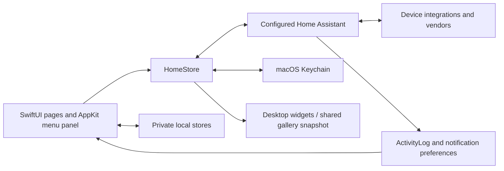

# Architecture

Hearth is a native macOS client for Home Assistant, not a hosted automation service. `Package.swift` defines one executable and its test target, with no external Swift package dependencies. The optional `WidgetExtension/` is built separately. Docker examples are external Home Assistant infrastructure, not a dependency of the app executable.

## Native host and views

The app's entry and menu host create the Home Assistant store, activity log, status item and panel. `Views/PanelView.swift` maps routes to climate, security, rooms, assets, map, activity and settings. `DockView`, `NavigationGlass`, `SlidingSelection` and `ScreenFlow` supply shared navigation and transitions. UI control changes should preserve saved route keys and supported device actions.

`Views/Theme.swift` supplies colors, type and common surfaces. Appearance follows the saved System/Light/Dark preference. Accessibility settings affect contrast, transparency and motion. Page headings and the bottom navigation share glass-opacity preferences; offscreen documentation uses an explicit static fallback rather than pretending to reproduce the system compositor.

## Connection and commands

`HomeStore.swift` owns connection state, entities, device/area/floor registries and commands. It uses Home Assistant HTTP endpoints for sign-in and related requests, and the WebSocket API for state, subscriptions and service commands. Device capabilities and availability come from these entities and registries. Hearth does not implement every manufacturer's device protocol directly.

Climate controls use the shared command, sequencing and reconciliation helpers; visual state must reflect a reported or pending result without inventing success. Other device families use their exposed Home Assistant actions. A simulated service response is not physical-device verification.

Authentication tokens belong in Keychain or an explicitly supplied development environment, not JSON data files. Network image loading, redirects and the temporary Home Assistant web window have separate origin boundaries. See [security policy](../SECURITY.md) and [local development](local-development.md) before using developer commands against a configured server.

## Local data and privacy

Homes, manual gadgets, imported maps, activity images and optional familiar-face samples live beneath the user's Application Support directory; display preferences use UserDefaults. `Homes`, `Gadgets`, `HomeMap`, `ActivityLog` and `FaceLibrary` manage these separate stores. The source repository does not contain a required production database dump.

Privacy blur is a display control, not deletion or encryption of saved images. Clearing the timeline does not currently remove its image files. Face matching uses Apple's Vision framework locally. Retention and operational backup changes need an explicit data-preservation decision. See [retention and network proposals](retention-network-proposal.md).

## Video, art and map

`Views/LiveVideoView.swift` follows Home Assistant streaming/signalling. Stream support still depends on the camera integration. Native Canvas drawing code provides device illustrations; `ACUnitView` animates airflow and `SpeakerGrid` presents playback state.

`MapScene.swift` and `MapDeviceModel.swift` build the SceneKit view and illustrative devices. Optional Metal contact-lighting code has a native fallback. A demo model is not a measured plan; imported scans and device placements remain private user data. See [map](3d-map.md) and [lighting](map-lighting.md).

## Widgets

Desktop widgets are app-managed windows observing the live store. The optional WidgetKit extension instead reads a limited App Group snapshot. It has no Home Assistant credentials or direct connection. Provisioning, signing and gallery validation are separate from compiling the extension. See [widgets](widgets.md).

## Development and publication boundaries

`DemoEngine` and `PreviewExporter` create isolated sample data. `--render-preview` exits before connecting to Home Assistant. Tests use fixtures and injected boundaries; they do not require production credentials. Optional Home Assistant test entities require [manual bootstrap](local-development.md#optional-home-assistant-fixtures).

A private operational checkout and an independent, allowlisted public source history are kept separate. Public changes are reviewed and tested before being integrated into an installed app. Ignored data, pairing state and credentials must not be treated as disposable during source updates. Build/release scripts stage artifacts separately and do not make an unreviewed contribution safe merely by compiling it.

Useful entry points: [contributing](../CONTRIBUTING.md), [model tests](model-regressions.md), [release policy](release-policy.md), [source publication checklist](source-release.md) and [asset/excerpt provenance](provenance-register.md).
