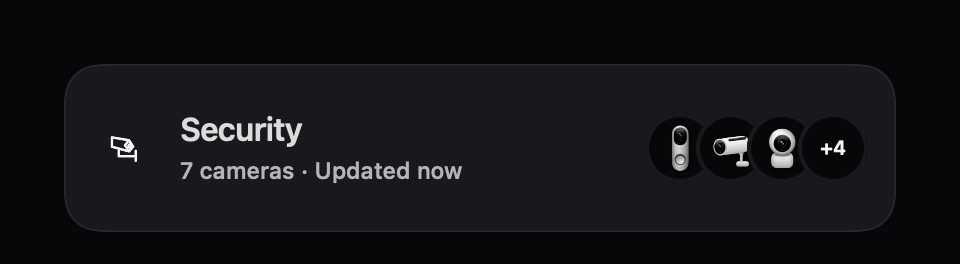
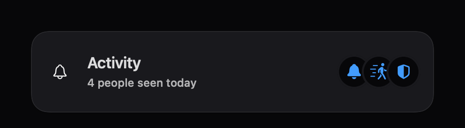
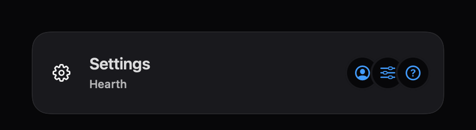
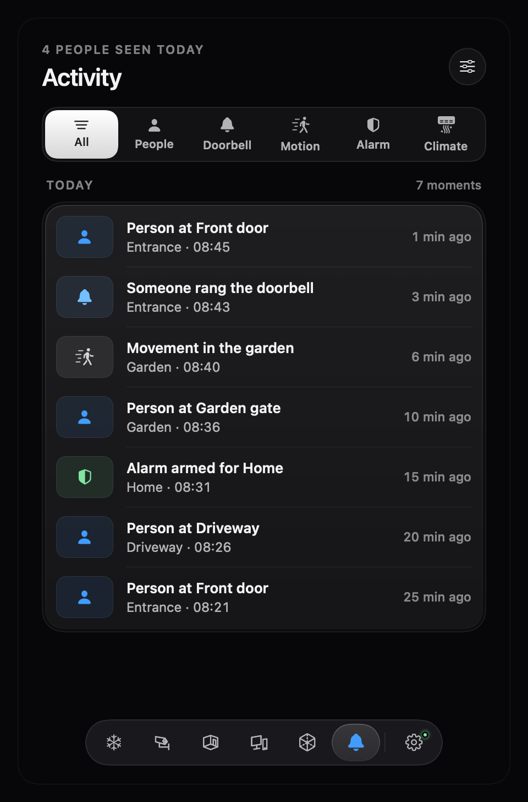

# Floating navigation

The bottom navigation bar floats over scrolling content. There is no full-width blackout or blur strip. Scroll to bring the final controls completely above the bar. Fixed climate controls and the demo exit remain above it.

In **Settings → Navigation**, adjust **Glass opacity** from clearer to more opaque. The default is 55%. The setting changes the navigation and floating heading surfaces; icons and labels retain full opacity. The value is remembered between launches.

**Reduce Transparency** or **Increase Contrast** in macOS keeps the bar solid and temporarily disables the slider. Your chosen value is retained for when those settings are turned off. **Reduce Motion** removes the lens stretch; ordinary motion is restrained and pending settling animations are cancelled when another tab is chosen.

The scrolled page heading becomes a compact rounded card, inset 16 points from the panel’s top and sides. Its 84-point height leaves room for the title and update summary. The surface uses the same translucent glass and saved opacity as navigation; blur stays within the rounded frame. Security adds overlapping circular camera illustrations and a remaining-camera count; Assets, Rooms, speakers and the map use their existing device illustrations. Activity uses overlapping doorbell, motion and alarm symbols; Settings uses account, preferences and help symbols. These are illustrations, never camera footage. The original heading fades before its title reaches the clipping edge. Back buttons remain actionable, and VoiceOver switches between the original and floating heading at the midpoint.

The **Assets** section contains homes, energy, vehicles, gadgets and speakers. This is a display-name update: saved routes, hidden-section choices, device links and Home Assistant's own Devices terminology remain compatible.

## Menu-bar updates

An open panel retains its presentation position while the menu-bar status rotates. Hearth reserves a bounded slot for the currently enabled status lines while the panel is open, centers the capsule artwork inside it and releases that space when the panel closes. Display changes and explicit repositioning can reanchor it; the panel still stays within the usable screen.

macOS owns the positions of neighboring menu items. Very long incoming text may truncate in the bounded slot; its full text remains available to VoiceOver and in the tooltip. This does not claim control over the system menu-bar layout.

## Documentation images

The navigation guide shows the real Settings navigation section in isolation, using an offline demo context. The slider, section switches and dock material are drawn statically for offscreen rendering; the running app uses native interactive controls and adaptive glass. The heading close-ups also use the static solid documentation fallback; native glass is checked in the running app. No household configuration is included.

### Activity and Settings

## Activity filters

All six existing filters are visible in one compact tray with equal-width icon/label controls. One selected key moves between them; filters no longer scroll into clipped side margins. The page viewport reaches the window edges while its content keeps 22-point margins, so the heading floats over content without a separate top or side cutout.

