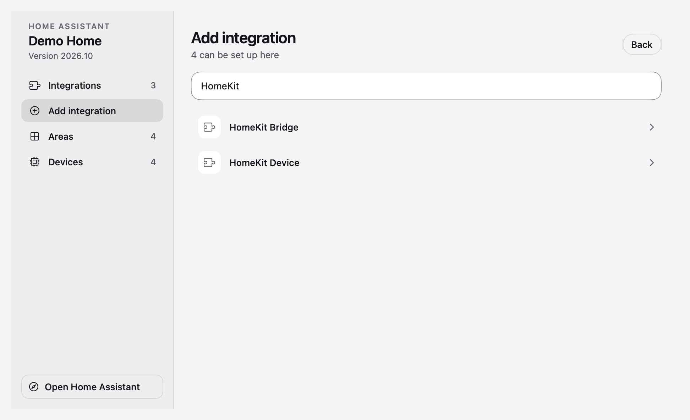

# Using Hearth

Hearth brings a Home Assistant installation into the Mac menu bar. It reads the entities and registries your server exposes; available controls depend on the integration, model and permissions.

## Connect your own server

### 1. Confirm the address

Install the preview or [build without replacing an existing app](local-development.md). Open your Home Assistant in a browser first and note its address. Use the same address in Hearth, including the port when required. The examples below are generic; enter your own server. Prefer HTTPS on shared or remote networks.

### 2. Sign in from the menu bar

Open Hearth and enter the address, your **Home Assistant username** and password, then choose **Sign in**. No separate Hearth account is required. The password is not saved; the refresh token is stored in Keychain.

<table>
  <tr>
    <td valign="top" width="50%">
      <h3>Your server and account</h3>
      
      
Fields are static documentation illustrations. No usable password or token is included.

    </td>
    <td valign="top" width="50%">
      <h3>Check the connection</h3>
      
      
Confirm the server and connection status, then browse Assets or Rooms. This is an offline sample account.

    </td>
  </tr>
</table>

MFA completion is not supported in the current Hearth sign-in flow. Keep MFA enabled and use Home Assistant's supported clients while that limitation remains. The developer token path in [local development](local-development.md#authentication-and-isolation) is for an isolated test server, not a reason to change an operational account's protection.

### 3. Check the connection

Open **Settings** using the gear, then the **Signed in as… / Server & integrations** row. The Account page shows connection status and integration/device counts. On an upgrade with an older saved sign-in, Hearth may first ask you to confirm the saved server locally. Review that address before confirming; the old credential remains private.

macOS notification permission is optional. Choose it if you want system alerts for enabled events; it does not determine whether Home Assistant devices load.

| What you see | Next check |
|---|---|
| Cannot reach the server | Open the same address in a browser; check that the Mac can reach the server |
| Sign-in rejected | Confirm the Home Assistant account and whether MFA is requested; keep MFA enabled |
| Connected but no matching devices | Check that the integration has entities in Home Assistant and that devices are assigned to rooms |
| Setup form asks for a browser | Finish the displayed provider handoff, then return to Hearth |

## Add and review integrations

An integration connects Home Assistant to a device or service. Hearth reads that server's catalog and renders supported setup forms; it is not a separate integration marketplace.

1. In Hearth, open **Settings → Signed in as… → Integrations and devices**. The native management window opens on **Integrations**.
2. Choose **Add integration**, then search for the brand or service. A HACS badge identifies a community integration already present on the server; Hearth does not install HACS packages.
3. Follow the requested fields and local pairing steps. Browser authorization opens separately when required; return and choose **I've finished, continue** when the flow asks.
4. If Hearth cannot display a step, use **Open in Home Assistant** to continue through the server's own interface. You can always start there at **Settings → Devices & services → Add integration**. [Home Assistant's official setup guide](https://www.home-assistant.io/getting-started/integration/).
5. Check the integration's status and devices. Assign its devices to rooms in Home Assistant, then open **Rooms** or the matching family in **Assets**.

Integration options can reload, disable or delete server entries; these affect the actual home. They are not needed to explore the app or generate sample screenshots. Provider permissions, discovery, hardware and supported entity types determine which controls appear.

### Review, then add

The manager groups entries by integration. The example uses invented names and working states; it is not connected to a home.

Search the catalog provided by your server. The similarly named HomeKit entries move devices in different directions.

### Apple Home and HomeKit

Use [the HomeKit walkthrough](homekit.md) to choose **HomeKit Device** for importing compatible accessories, or **HomeKit Bridge** for using selected Home Assistant entities in Apple Home. Hearth has no direct Apple Home household-import feature. Keep pairing codes private and preserve a working Home setup until you have chosen a migration plan.

## Choose a destination

| View | What it organizes | Typical next action |
|---|---|---|
| Climate | Individual climate entities | Open a unit; adjust a supported set point or mode |
| Security | Cameras and alarm systems | Open a live camera, inspect an event or use an exposed alarm control |
| Rooms | Home Assistant rooms and their devices | Browse an overview or select a room in the interactive layout |
| Assets | Homes, energy, vehicles, gadgets and speakers | Open a family or a specific asset |
| 3D map | A demo house or your imported scan | Select a floor; place a device; switch 3D/Plan |
| Activity | People, doorbell, motion, alarm and climate events | Filter the timeline and adjust notification preferences |
| Settings | Connection, appearance, navigation, widgets and help | Choose glass opacity or create a support draft |

## Control a device

Open the device itself rather than assuming every card offers the same functions. Online status, supported modes and exposed actions come from Home Assistant. A service accepting a request does not prove that a physical device carried it out. When an action fails, inspect the reported state and test the same action in Home Assistant before changing the installation.

Cooling airflow becomes a fuller, pale mist toward the device’s lower set points. Fan speed and set point influence the illustrated wind; heat, dry and fan-only keep their own visual cues.

Climate numbers are sample readings. A unit may expose cooling without heating, a different temperature step, or fewer fan/swing options. Unavailable functions are not invented.

## Browse and play speakers

Open **Assets → Speakers** and choose grid or list. Group labels describe the integration's reported group, while each card shows its room and state. Playback and announcements depend on the speaker integration; availability in an offline screenshot is not a guarantee for every speaker. Do Not Disturb and provider permissions may affect announcements.

## Navigate rooms

Rooms uses Home Assistant's room and floor assignments. The overview groups rooms by floor. The interactive view lets you select a floor and room, inspect its devices, and open the same device detail controls. It is a registry-based layout, not a measured 3D floor plan. Use **3D map** for a scanned home.

<table>
  <tr>
    <td valign="top" width="50%">
      <h3>Overview</h3>
      
    </td>
    <td valign="top" width="50%">
      <h3>Interactive</h3>
      
    </td>
  </tr>
</table>

## Arrange a map

The demo map uses simulated energy readings. Import a scan only when you are ready to use a private home layout. Drag a device to the floor or a wall; the sidebar keeps the device available and indicates placement. Read the [map guide](3d-map.md) for supported formats and navigation.

## Tune navigation and notifications

In **Settings → Navigation**, choose glass opacity. Floating headings share that preference. macOS Reduce Transparency and Increase Contrast override translucency for legibility. Activity filters select what appears in the timeline; notification preferences control which events can alert you. They are separate choices.

## Ask for help

Use **Settings → Help & Support** to prepare a draft. Review its text before opening your mail app, or copy it into webmail for `contact@elvisobi.com`. Hearth does not send it automatically. Do not include tokens, private camera pictures, exact household addresses or unredacted logs. [Support guide](../README.md#8-get-help-or-report-a-problem) and [security reporting](../SECURITY.md) have separate routes.

All images in this guide are generated from isolated sample data; see the [image register](screenshots/README.md) for limitations.

## Refresh and status timing

In **Settings**, **Camera refresh** offers intervals from 30 to 480 seconds for the camera grid's periodic snapshots. This preference does not stop an open live stream or change its independent fallback behavior. Longer intervals reduce periodic snapshot requests; device battery behavior also depends on the integration and camera.

Under **Menu bar**, **Rotate every** offers intervals through 60 seconds. Alerts retain their existing priority. Existing saved choices are preserved; changing these menus does not reconnect or re-pair devices.
